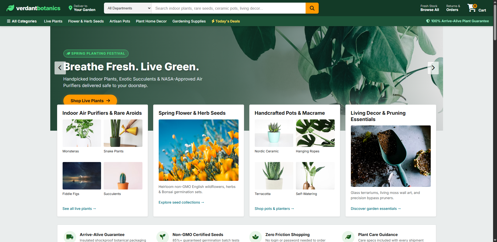
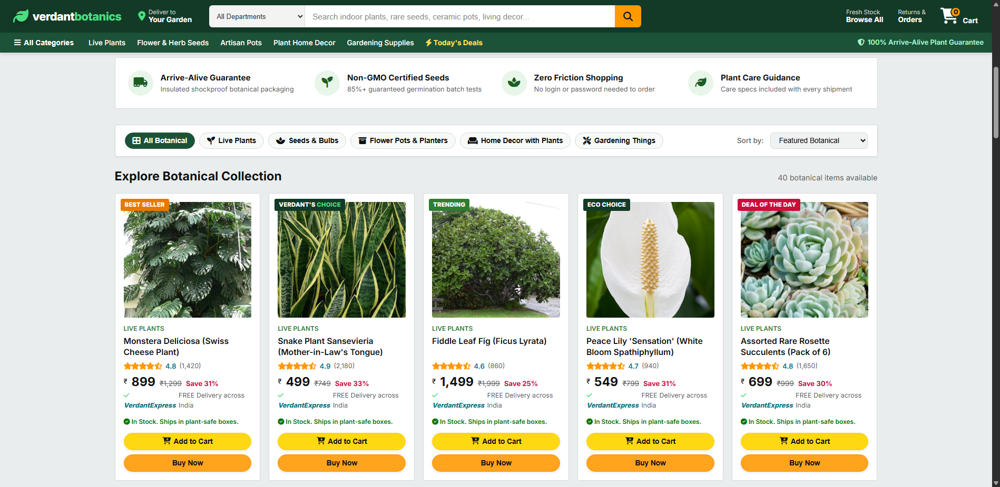
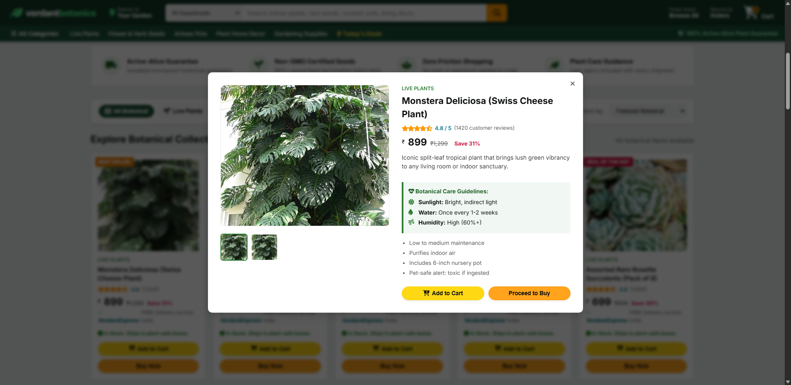
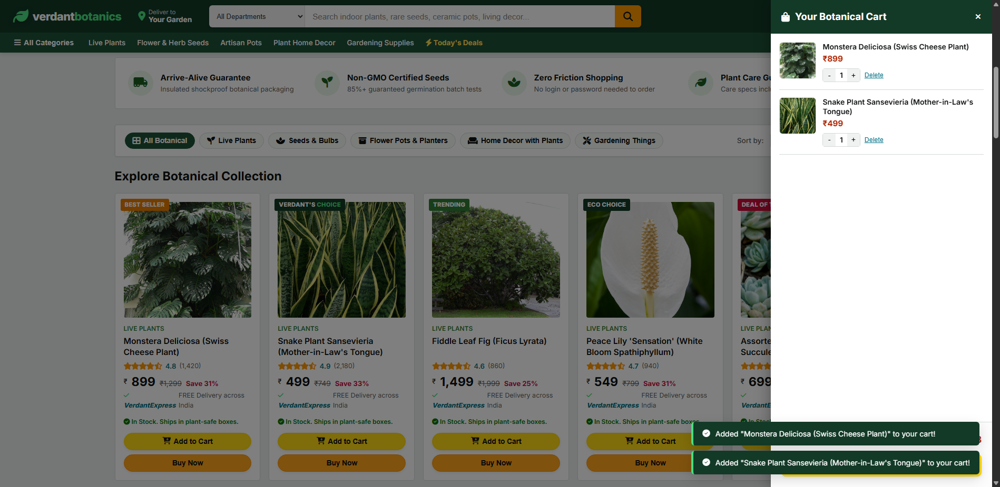
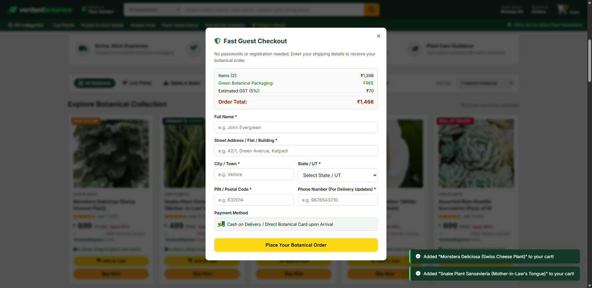
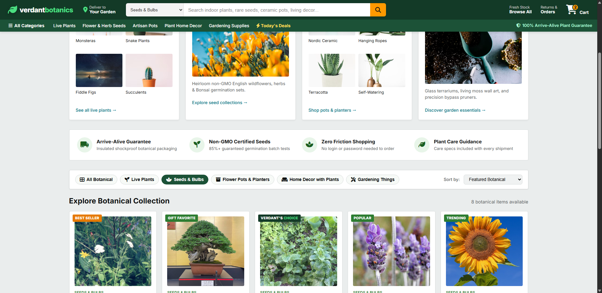

# 🌿 Botanical Sanctuary — Amazon-Style Botanical & Gardening E-Commerce Platform

[](https://www.python.org/)
[](https://flask.palletsprojects.com/)
[](https://developer.mozilla.org/)
[](https://opensource.org/licenses/MIT)

> **Botanical Sanctuary** is an Amazon-style e-commerce web platform engineered for indoor plant collectors, home gardeners, and landscaping enthusiasts. It combines a familiar shopping experience with features tailored to plants and botanical care.

---

## 📸 User Interface Showcase

| 01. Homepage & Hero Carousel | 02. Product Catalog Grid |
| :---: | :---: |
|  |  |

| 03. Quick-View Modal & Care Guide | 04. Slide-Out Shopping Cart Drawer |
| :---: | :---: |
|  |  |

| 05. Instant Checkout Modal | 06. Department Filter (Seeds) |
| :---: | :---: |
|  |  |

---

## ✨ Key Features

- **🛒 Amazon-Inspired User Experience**:
  - Dark top navigation bar with botanical branding.
  - Universal search bar with real-time department dropdown filtering.
  - Horizontal department ribbon for quick category switching.
  - Interactive hero banner carousel showcasing deals and curated seasonal highlights.
- **🌱 5 Curated Botanical Departments**:
  1. **Live Plants** — Low-maintenance indoor plants, air-purifiers, succulents, and tropical flora (Monstera, Snake Plant, Fiddle Leaf Fig, etc.).
  2. **Flower & Herb Seeds** — Heirloom vegetables, vibrant flowering blooms, and culinary herbs.
  3. **Pots & Planters** — Handcrafted ceramic pots, terracotta planters, geometric modern containers, and hanging planters.
  4. **Home Botanical Decor** — Geometric glass terrariums, wooden multi-tier plant stands, and hydroponic propagation stations.
  5. **Gardening Tools & Essentials** — Ergonomic bypass pruners, brass watering cans, organic potting mix, and soil moisture meters.
- **🔍 Plant Care Specifications**:
  - Every product card features ratings, review counts, stock badges (*Best Seller*, *Prime Choice*), and discount tags.
  - Quick-view modal with sunlight requirements, watering schedules, and humidity tips.
- **🛍️ Complete Client-Side Cart Flow**:
  - Slide-out cart drawer with animated drawer overlays.
  - Live subtotal recalculations, quantity adjustment (`+` / `-`), and single-click item removal.
  - Direct checkout dialog with shipping address collection, payment method selector (UPI, Credit/Debit Cards, Cash on Delivery), and order confirmation.
- **⚡ Fast RESTful Backend**:
  - Lightweight Flask blueprint architecture with REST endpoints (`/api/products`, `/api/categories`, `/api/checkout`).

---

## 🏗️ Project Architecture

```
Botanical-Sanctuary/
├── run.py                          # Flask entrypoint script
├── requirements.txt                # Python dependencies
├── README.md                       # Project documentation & UI showcase
│
├── app/
│   ├── __init__.py                 # Application factory & blueprint registration
│   ├── config.py                   # Configuration settings
│   │
│   ├── routes/
│   │   ├── __init__.py
│   │   └── main.py                 # REST APIs (/api/products, /api/checkout) & store views
│   │
│   ├── static/
│   │   ├── css/
│   │   │   └── style.css           # Amazon-style botanical theme, animations & responsive styling
│   │   │
│   │   ├── js/
│   │   │   └── main.js             # Cart state, dynamic catalog, search, and modal handling
│   │   │
│   │   └── images/products/        # High-resolution botanical product images
│   │
│   └── templates/
│       ├── base.html               # Amazon navbar, department ribbon, cart drawer & modals
│       └── index.html              # Hero carousel, department spotlight cards & product grid
│
└── screenshots/                    # High-resolution UI captures of all store states
    ├── 01_homepage_hero.png
    ├── 02_product_catalog_grid.png
    ├── 03_product_detail_modal.png
    ├── 04_cart_drawer.png
    ├── 05_checkout_modal.png
    ├── 06_category_filter_seeds.png
    ├── 07_category_filter_pots.png
    └── 08_category_filter_tools.png
```

---

## 🚀 Quick Start Guide

### 1. Prerequisites
- Python 3.10+ installed
- Git installed

### 2. Clone Repository
```bash
git clone https://github.com/divya180715/Botanical-Sanctuary---Amazon-Style-Botanical-Gardening-E-Commerce-Platform.git
cd Botanical-Sanctuary---Amazon-Style-Botanical-Gardening-E-Commerce-Platform
```

### 3. Create & Activate Virtual Environment
```bash
# Windows
python -m venv venv
venv\Scripts\activate

# macOS / Linux
python3 -m venv venv
source venv/bin/activate
```

### 4. Install Dependencies
```bash
pip install -r requirements.txt
```

### 5. Run Application
```bash
python run.py
```

Open your browser and navigate to:
```
http://127.0.0.1:5000
```

---

## 📡 REST API Reference

| Method | Endpoint | Description |
| :--- | :--- | :--- |
| `GET` | `/` | Serves the main store storefront template |
| `GET` | `/api/products` | Retrieve catalog with optional filters (`?category=plants&q=monstera&sort=price_low`) |
| `GET` | `/api/products/<id>` | Fetch detailed metadata for a single product |
| `GET` | `/api/categories` | List all botanical categories and department counts |
| `POST` | `/api/checkout` | Submit an order and receive an order confirmation code |

---

## 📄 License
This project is licensed under the [MIT License](LICENSE).
